# 🚢 M.V. PACIFIC HORIZON — 單頁 3D 貨輪模擬器 (3D Cargo Ship Simulator)

> **線上立即試玩（GitHub Pages）**：👉 **[https://pondahai.github.io/cargo-ship-simulator/](https://pondahai.github.io/cargo-ship-simulator/)**

一款以**單一網頁檔案（Single-Page HTML + Three.js）**打造的 3D 貨輪第一人稱探索模擬器。全船依據真實支線貨櫃輪（Feeder Container Ship / Damen Combi Freighter）的**總佈置圖（General Arrangement Plan, GA Plan）**與 SOLAS 國際公約配置建構，無需任何外部貼圖或建置步驟，打開瀏覽器即可從羅經甲板一路徒步探索到水線下 62 公尺管路通道與船首側推器室。

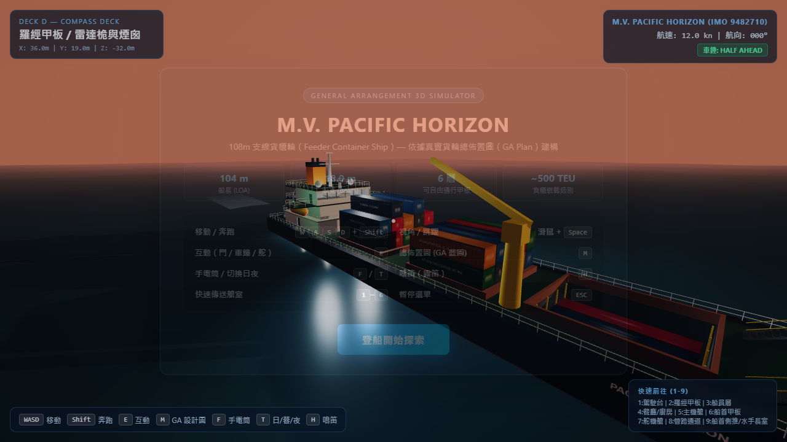

---

## ✨ 船舶規格（1:1 真實比例）

| 項目 | 規格 |
| :--- | :--- |
| **船名 / IMO** | `M.V. PACIFIC HORIZON` (IMO 9482710) |
| **船長 × 船寬** | `104 m (LOA) × 18.0 m (Beam)` |
| **貨櫃規格** | 100% 真實 40 呎 ISO 標準貨櫃（`2.44m × 2.59m × 12.19m`） |
| **可探索空間** | 6 層甲板 ＋ 船尾舵機艙 ＋ 62m 甲板下雙層船殼管路通道 ＋ 船首側推器室／水手長儲藏室 |
| **技術架構** | 純單頁 `index.html`、Three.js WebGL、程序化 Canvas 貼圖、自訂海面裁切 Shader、Web Audio API 即時音效 |

---

## 🎮 遊戲方式與操作說明

點擊畫面中央「**登船開始探索**」進入第一人稱視角：

| 按鍵 | 功能說明 |
| :--- | :--- |
| `W` `A` `S` `D` | 前後左右移動（支援平滑上下所有室內外樓梯與過橋） |
| `Shift` | 奔跑加速 |
| `滑鼠` / `Space` | 自由環顧視角 / 跳躍 |
| `E` | 與水密門、艙室門、駕駛台**車鐘**（調整航速與主機轉速／音效）、**舵輪**（連動船尾舵機艙液壓舵柄）互動 |
| `M` | 開啟 **2D 總佈置設計圖（GA Blueprint）**，含側視剖面圖與俯視圖即時定位 |
| `F` | 開啟／關閉隨身手電筒（探索機艙、管路通道與夜間航行必備） |
| `T` | 切換環境時間：**晴朗白天 → 海上黃昏 → 夜間航行（駕駛台自動切換紅光夜視模式）** |
| `H` | 鳴放貨輪霧笛（Web Audio API 合成低頻船笛） |
| `1` – `9` | 快速傳送至各主要艙室 |
| `ESC` | 暫停／返回選單 |

### 快速傳送鍵（`1` – `9`）
- `1` 駕駛台（Navigation Bridge）｜`2` 羅經甲板（Compass Deck）｜`3` Deck B 船長與船員層
- `4` Deck A 餐廳與廚房層｜`5` 主機艙底層（Main Engine Room）｜`6` 船首甲板（Forecastle）
- `7` 舵機艙（Steering Gear Room）｜`8` 62m 甲板下管路通道（Pipe Tunnel）｜`9` 船首水手長儲藏室（Bosun's Store）

### 🧭 推薦全船徒步貫穿路線
> 駕駛台 (`1`) → 下樓逛船長室／醫務室／船員臥室 → 下樓逛廚房／餐廳／交誼廳與健身房／洗衣間 → 下樓進機艙控制室（ECR）與船尾**舵機艙** → 下至主機艙底層 → 開啟紅色水密門穿越 **62 公尺管路通道** → 抵達**船首側推器室**並走上**跨側推鋼構過橋樓梯** → 爬上**船首水手長儲藏室** → 走出主甲板貨櫃區並登上**船首甲板**！

---

## 🛠️ 開發過程紀實（Gemini Neon Vibe Coding）

本專案全程採用 **Gemini Neon Vibe Coding** 模式開發——開發者透過自然語言提出航海需求、即時試玩並回報體感與畫面問題，由 **Gemini Neon** 自主查閱真實船舶設計資料、撰寫 3D 空間幾何與物理引擎並快速迭代修正：

1. **階段一：查閱真實貨輪 GA 設計圖並建構骨架**
   - 先從網路搜尋真實支線貨櫃輪（Feeder Container Ship）的 General Arrangement Plan 尺寸與分艙結構。
   - 在單一 `index.html` 中以 Three.js 建立船殼、3 個貨艙（含 1 號開放式貨艙與 Cell Guides）、多層住艙、全景駕駛台與雙層機艙，並實作多樓層 AABB 碰撞與斜坡樓梯物理系統。
2. **階段二：動線修正——解決樓梯緊貼牆壁**
   - 試玩發現住艙 3 座往上樓梯（Deck A→B、B→C、C→D）頂端緊貼後牆與護欄。
   - 透過直接檢視 3D 幾何座標，將 3 座樓梯反轉改為「由船尾向船首方向上樓」，並同步調整各層樓板開口與護欄，讓每一層上下樓都直接正對開闊走廊。
3. **階段三：水線下防水——海面 Shader 船殼裁切**
   - 解決海面平面穿透水線下機艙與貨艙的問題：在海面材質的 `onBeforeCompile` 注入自訂 Fragment Shader，依船體水線輪廓精準裁切船殼內部的海面像素，實現水線下空間 100% 乾燥。
4. **階段四：補齊真實商船生活設施**
   - 全面擴充 Deck A 與 Deck B：打造具備四口電爐、抽油煙機、雙槽流理台與冷凍庫的**船舶廚房（Galley）**，以及**船員餐廳、交誼廳與健身房、洗衣間與衛浴、醫務室、船長室、船員上下舖臥室**，並加上中英文艙室銘牌。
5. **階段五：依據真實 GA 藍圖與 SOLAS 規範打通全船水線下空間**
   - 進一步比對 Damen Combi Freighter 3850 與商船 SOLAS 規範，新增**船尾液壓舵機艙（與駕駛台舵輪連動）**、**62 公尺雙層船殼管路通道**、**船首側推器室**、**船首水手長儲藏室（含錨鏈管）**、**機艙車床修造間**，以及**應急發電機室與 CO₂ 滅火室**。
6. **階段六：中空雙層船殼重構與側推過橋樓梯**
   - 針對試玩回報的機艙底層紅面穿模、船首水手長室牆面重疊與底艙破洞，將實心船底與船首全面重構為**中空雙層船殼結構**，封閉轉接玄關，並在船首側推器室架設**跨側推隧道鋼構過橋樓梯**，完成全船無死角探索體驗。

---

## 📸 全船各位置實機截圖導覽

### 1. 駕駛台（Deck C — Navigation Bridge）
全景船橋視窗、即時掃描雷達、ECDIS 電子海圖、可互動車鐘與舵輪。
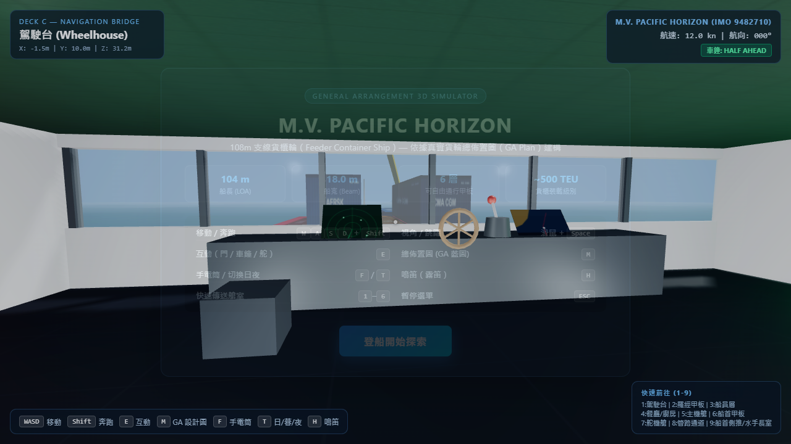

### 2. 羅經甲板（Deck D — Compass Deck）
磁羅經、旋轉 X/S-Band 雷達桅、衛星通訊天線罩與紅藍煙囪。
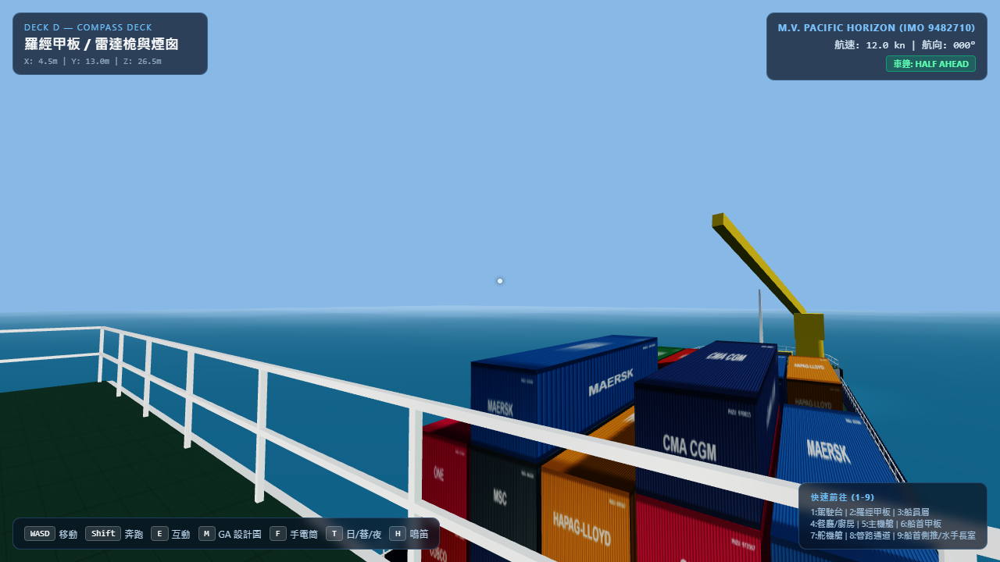

### 3. 船長室（Deck B — Captain's Suite）
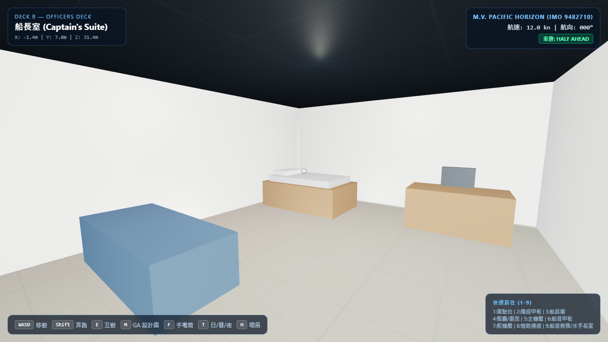

### 4. 醫務室（Deck B — Hospital）
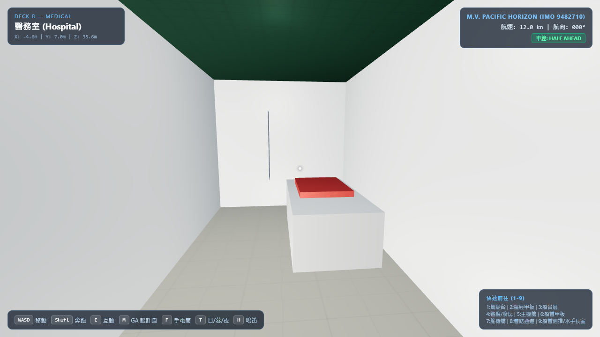

### 5. 船員臥室（Deck B — Crew Cabin）
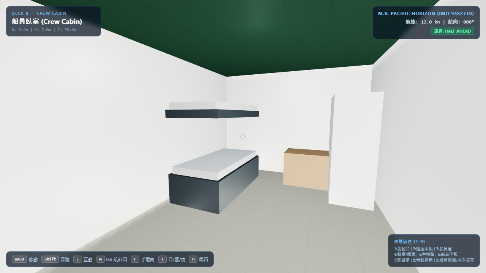

### 6. 船舶廚房（Deck A — Galley）
四口發熱船用電爐、抽油煙機、雙槽流理台、中島台與步入式冷凍庫。
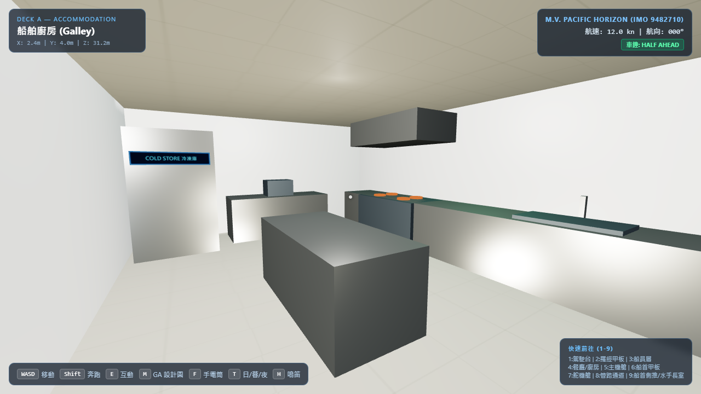

### 7. 船員餐廳（Deck A — Crew Mess Room）
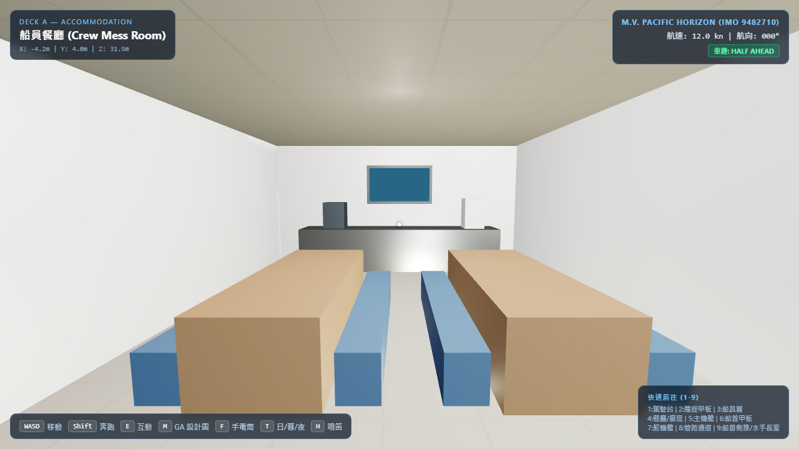

### 8. 交誼廳與健身房（Deck A — Recreation Room & Gym）
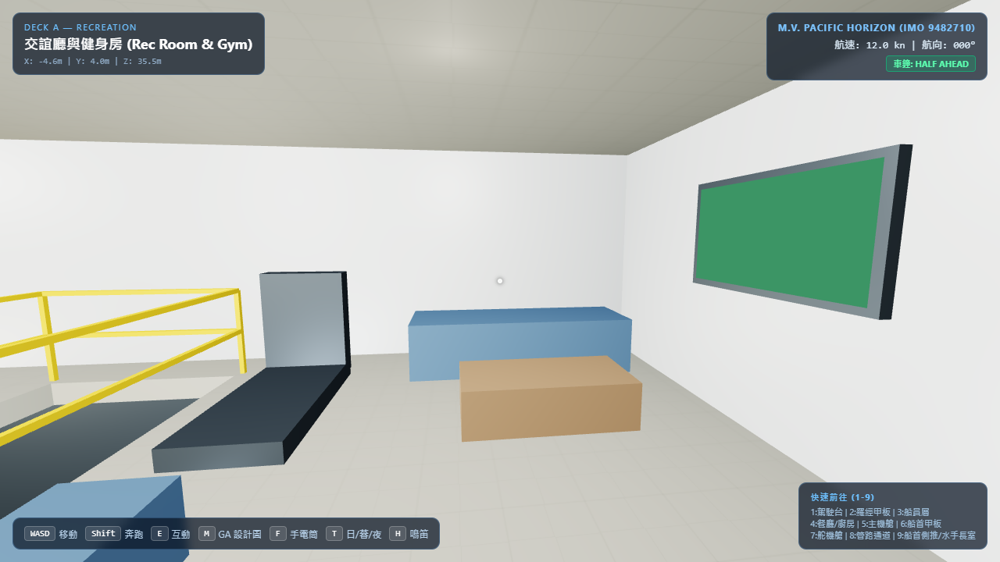

### 9. 洗衣間與衛浴（Deck A — Laundry & Washroom）
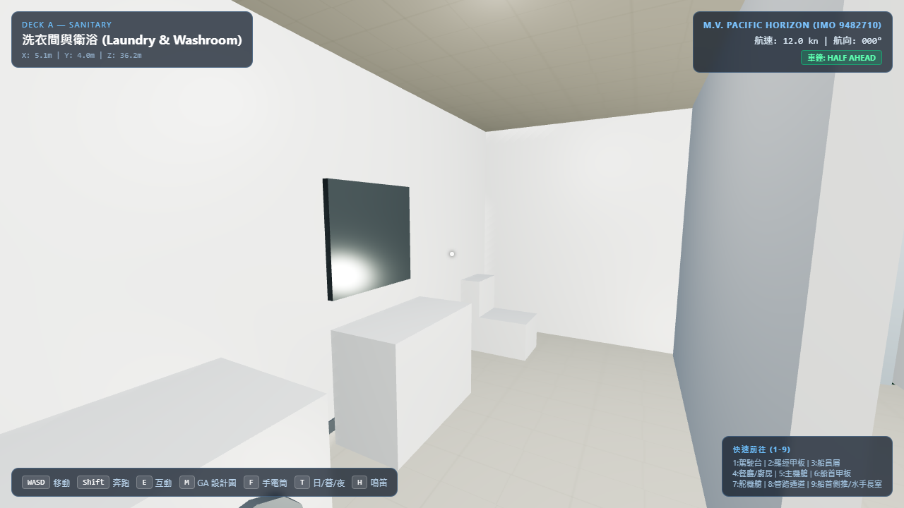

### 10. 主甲板貨櫃區與 1 號開放式貨艙（Main Deck Cargo Area）
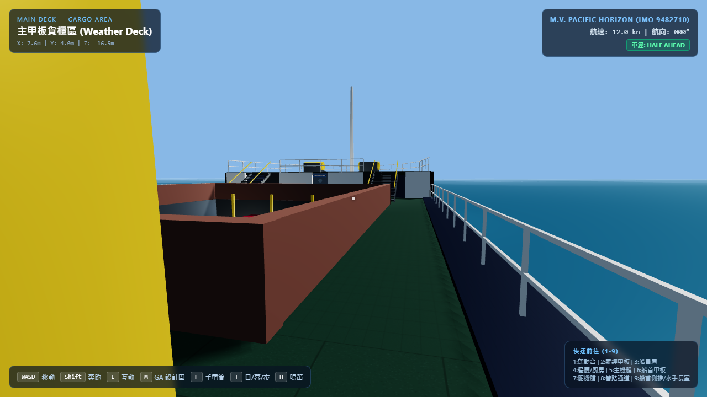

### 11. 船首甲板（Forecastle Deck）
雙組錨機、錨鏈、前桅與海平面視野。
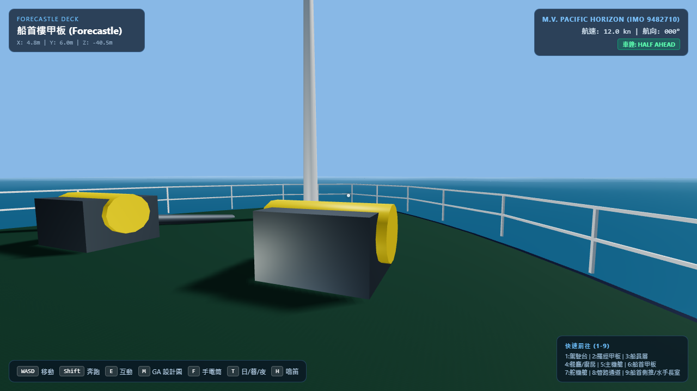

### 12. 主機艙底層（Main Engine Room）
6 缸二衝程主柴油機、連動車鐘轉速的飛輪、傳動軸與色碼管路。
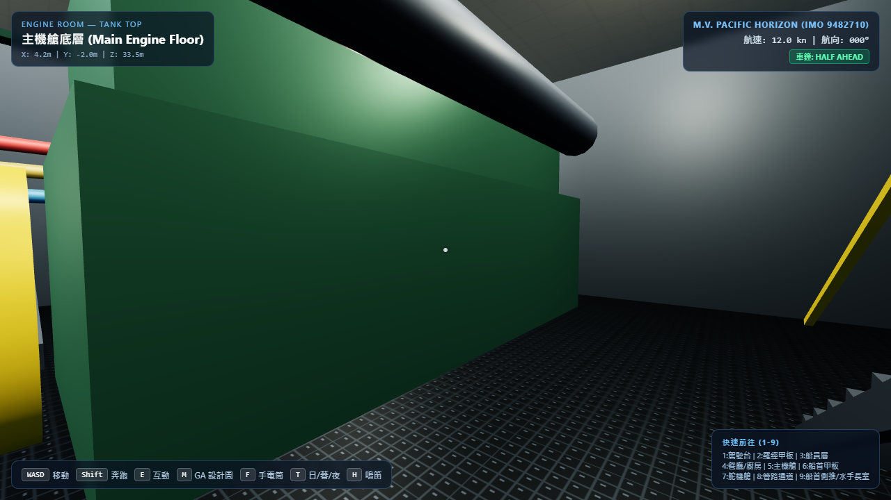

### 13. 船尾舵機艙（Steering Gear Room）
四缸液壓舵機、舵柱（隨駕駛台轉舵即時連動）與雙組液壓泵。
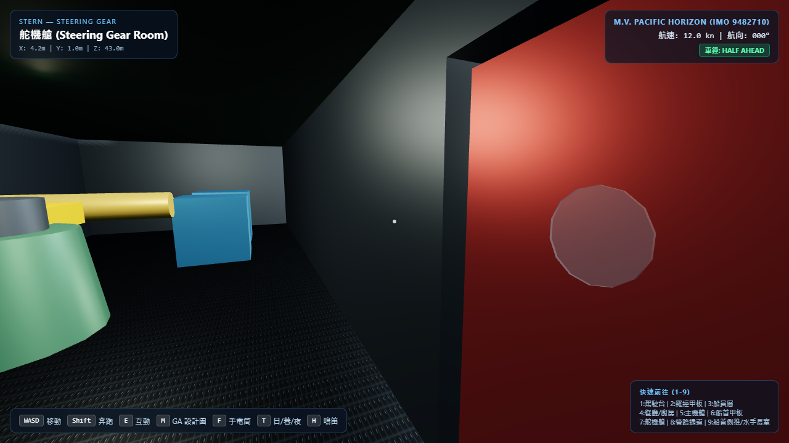

### 14. 62 公尺甲板下管路通道（Under-Deck Pipe Tunnel）
貫通機艙與船首的雙層船殼通道，內佈壓載水、燃油與消防管線。
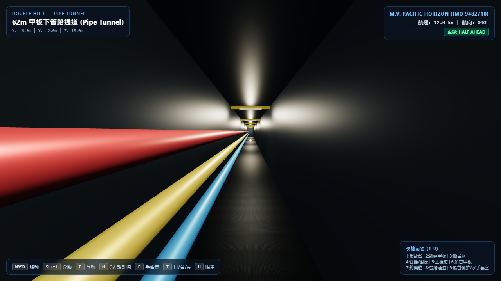

### 15. 船首側推器室與跨側推鋼構過橋樓梯（Bow Thruster Room）
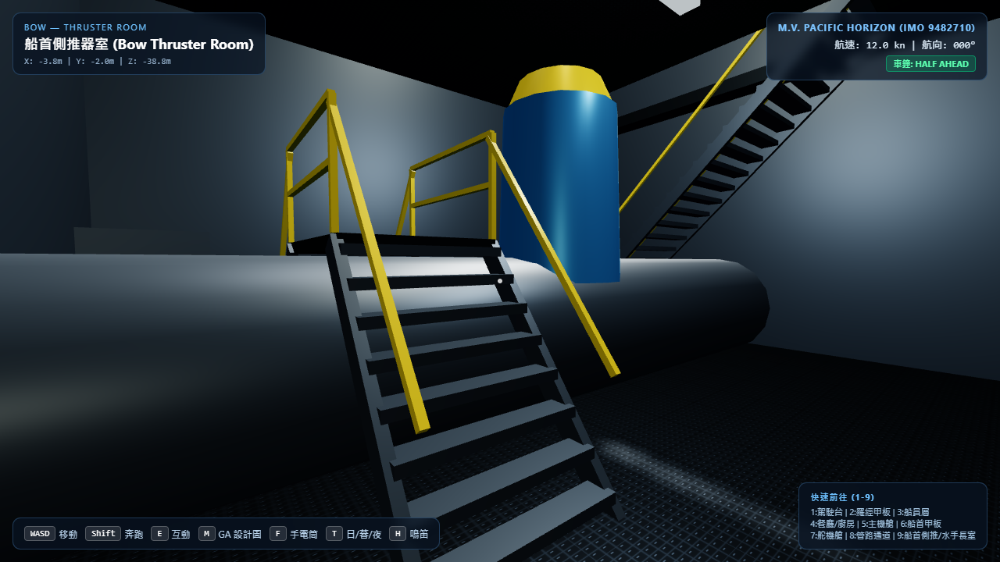

### 16. 船首水手長儲藏室（Bosun's Store）
直貫而下的雙錨鏈管、大型繫泊纜繩卷與工作台。
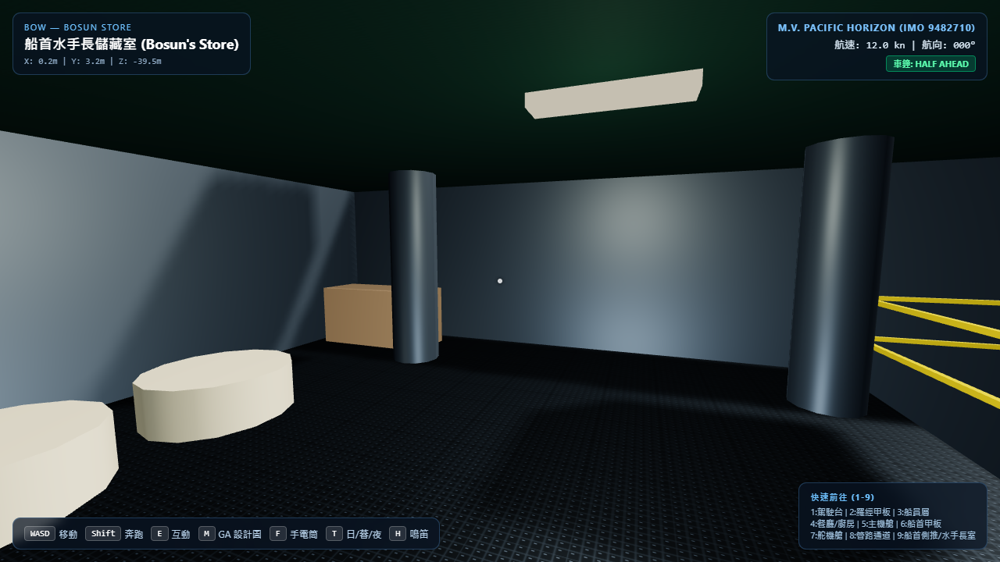

### 17. 2D 總佈置設計圖（General Arrangement Blueprint — 按 `M` 開啟）
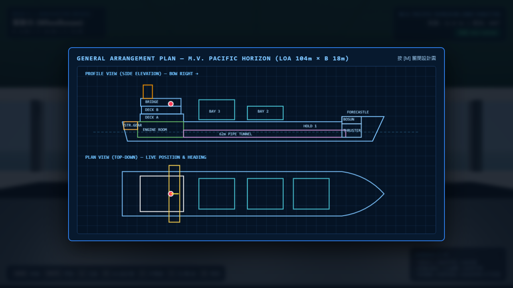

---

## 🚀 本機執行

無需安裝任何套件，直接下載並用瀏覽器開啟 `index.html` 即可遊玩！
